<picture>
  <source media="(prefers-color-scheme: dark)" srcset="./assets/header-dark.svg">
  
</picture>

<picture>
  <source media="(prefers-color-scheme: dark)" srcset="./assets/team-match-compact-v2-dark.svg">
  
</picture>

<picture><source media="(prefers-color-scheme: dark)" srcset="./assets/row-sr-dark.svg"></picture>

<dl><dd>Search and recommendation in one framework · co-first author (listed first) · with Prof. Zhenzhong Chen, Wuhan University 📄 <a href="https://dl.acm.org/doi/10.1145/3828659">Paper</a> · 💻 <a href="https://github.com/WItaZhang/UnifiedSSR-plus">Code</a></dd></dl>

<picture><source media="(prefers-color-scheme: dark)" srcset="./assets/row-risk-dark.svg"></picture>

<dl><dd>🔐 <b>TikTok</b> — account-takeover defense agent 💳 <b>Baidu</b> — pretrained credit scoring for multiple financial products 🥇 <b>1st place (team)</b> — cashflow credit-risk competition · 💻 <a href="https://github.com/WItaZhang/cashflow-credit-risk">Code</a></dd></dl>

<picture><source media="(prefers-color-scheme: dark)" srcset="./assets/row-ag-dark.svg"></picture>

<dl><dd><b>Job-search agent</b> — Finds roles, learns your preferences, and prepares applications · 💻 <a href="https://github.com/WItaZhang/codex-job-agent">Code</a> <b>Project Map</b> — Trace skills, tools, and MCP servers to source in your browser · 💻 <a href="https://github.com/WItaZhang/project-map">Code</a> · ▶ <a href="https://witazhang.github.io/project-map/">Demo</a> · 🎬 <a href="https://github.com/WItaZhang/project-map#watch-the-walkthrough">Video EN</a> / <a href="https://github.com/WItaZhang/project-map/blob/main/README.zh-CN.md#观看完整演示">中文</a></dd></dl>

Open to new-grad roles · [LinkedIn](https://linkedin.com/in/qianqian-zhang-2994a4384) · [Email](mailto:qianqian.zhang042@gmail.com)
